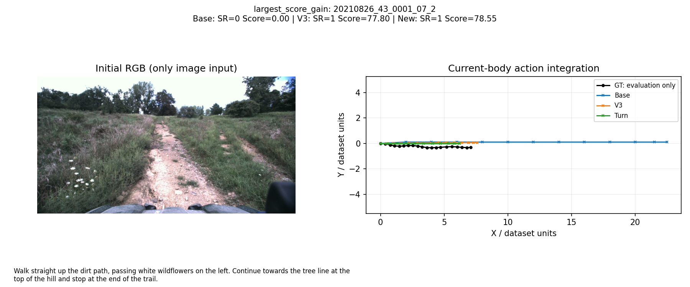
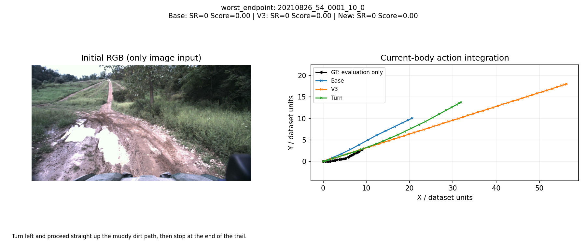
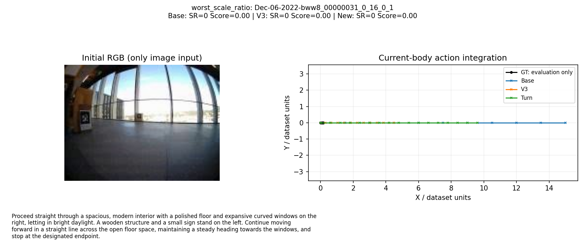
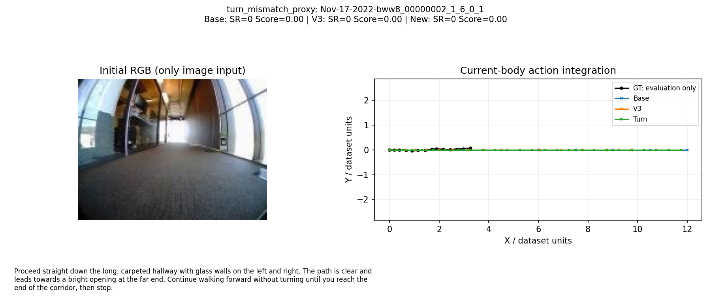
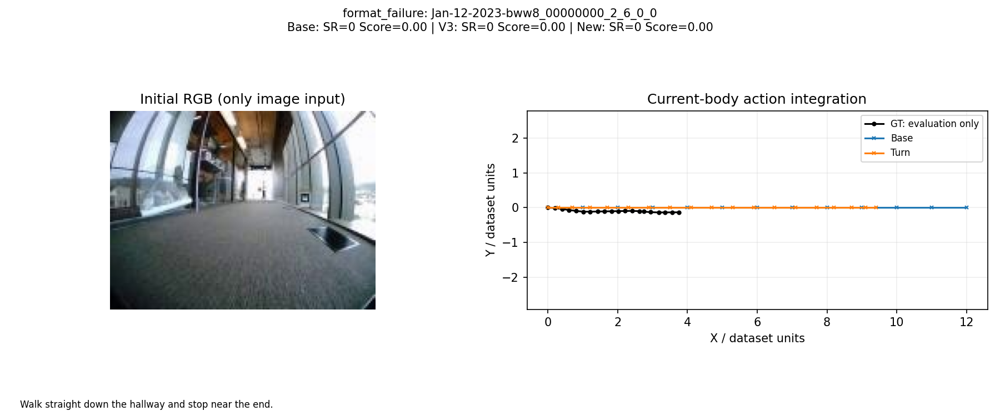
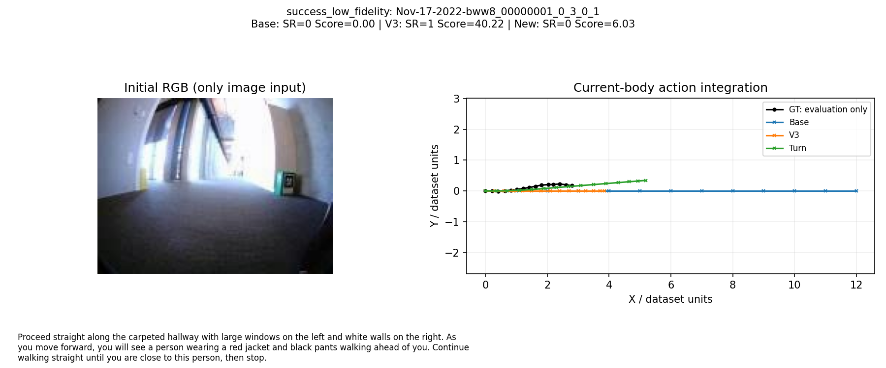

# 第二阶段成果入口

核验时间（UTC）：2026-10-31T05:51:23.068203+00:00。GPU分配0；以下为实际结果，不是实验计划。

## 关键结果

新完整归档100例与旧前缀100例是不同版本，分别配对。SR/Score使用计划分母，失败记零；其他指标用有效子集。

| 数据版本 | 策略 | 有效/100 | SR | Score |
|---|---|---:|---:|---:|
| 旧前缀100 | Base | 100/100 | 5.0% | 11.040 |
| 旧前缀100 | V3 | 98/100 | 17.0% | 27.756 |
| 旧前缀100 | Turn | 99/100 | 19.0% | 29.242 |
| 新完整归档100 | Base | 99/100 | 7.0% | 13.578 |
| 新完整归档100 | V3 | 94/100 | 23.0% | 32.431 |
| 新完整归档100 | Turn | 96/100 | 20.0% | 29.895 |

新集 Turn−V3：ΔScore=-2.536，95%配对区间[-7.511, 2.497]；**区间跨零，未获得稳定增益证据**。区间仅反映相应局部100例重采样，不是全量验证或CodaBench成绩。

## 交付文件

- [13页可编辑PPT](WorldNav_科研冲刺汇报_20261031_v2.pptx)、[PDF](WorldNav_科研冲刺汇报_20261031_v2.pdf)。
- [完整实验报告](stage2_experiment_report.md)、[逐页中文讲稿](stage2_speaker_notes.md)。
- [PPT来源与口径](stage2_ppt_sources.md)、[最终独立重算JSON](stage2_final_metrics.json)。
- [数据完整性](stage2_data_audit.json)、[轨迹组口径](stage2_trajectory_groups.json)。
- [服务器初始审计](server_audit_20261031.md)、[旧快照](stage2_freeze.json)、[旧SHA清单](stage2_frozen_sha256.json)、[新运行证据哈希](stage2_run_hashes.json)。
- [84项CPU/Mock完整测试名称和结果](stage2_cpu_tests.txt)。
- [Cosmos授权核查](stage2_model_access.json)、[LCVN任务产物复核](stage2_lcvn_checkpoint.md)。
- [32B视觉路由受控停止](stage2_vision_probe.json)；较小视觉模型探测见最终实验报告。

## 完成与未完成

已完成服务器审计、旧实验冻结与原始响应复算、两个验证集整包SHA和逐图片审计、五项开发集策略消融、旧100例Turn对照、新完整100例Base/V3/Turn实测和配对分析、真实案例图、新PPT/PDF及讲稿。
CPU/Mock共84项通过；真实模型调用分别记录请求与已报告Token，超时/中断的计费和服务端完成状态不猜测。

额外24-case开发清单已准备，**未执行24-case推理**。Cosmos Reason2-8B未运行，缺可用授权；LCVN仍缺已验收任务产物与GPU。小模型服务探测不冒充正式100例baseline。旧V3两条格式失败及所有新失败保持原样。

## 一页汇报要点

- 输入：初始单图+指令；输出：完整开放环机体坐标动作。
- 已建立可追溯API流程、冻结清单、严格解析、独立评测和有界恢复。
- Base→V3的旧集改善真实存在；Turn的增量必须由独立同清单对照判断，不能只看12例开发集。
- 完整验证归档已通过审计；episode是指令变体，轨迹哈希组才是去重物理路径。
- 公开demo不等于私有CodaBench；单图尺度、停止与转弯仍有误差。
- 下一步使用已准备24例独立开发清单进行确认，优先改进地标约束的分段距离与终止规划。

## 团队需要讨论的问题

1. 能否取得真正可用的Cosmos Reason2-8B托管endpoint或现有NVIDIA授权？
2. 谁负责向作者索取LCVN任务adapter、tokenizer/processor、基座版本和哈希？
3. 后续GPU如何明确分配，最小验收由谁负责？
4. 是否优先扩大独立开发集和几何诊断，避免继续对旧100例改Prompt？
5. 数据、模型服务、评测统计和科研汇报分别由谁长期维护？

## 真实成功与失败案例

图片为真实RGB与真实预测/GT的事后配对可视化，不作为模型输入。重复角色可能对应同一episode，选例规则和ID见完整分析JSON。

### largest_score_gain：val_unseen__20210826_43_0001_07_2

Walk straight up the dirt path, passing white wildflowers on the left. Continue towards the tree line at the top of the hill and stop at the end of the trail.

### worst_endpoint：val_unseen__20210826_54_0001_10_0

Turn left and proceed straight up the muddy dirt path, then stop at the end of the trail.

### worst_scale_ratio：val_seen__Dec-06-2022-bww8_00000031_0_16_0_1

Proceed straight through a spacious, modern interior with a polished floor and expansive curved windows on the right, letting in bright daylight. A wooden structure and a small sign stand on the left. Continue moving forward in a straight line across the open floor space, maintaining a steady heading towards the windows, and stop at the designated endpoint.

### turn_mismatch_proxy：val_seen__Nov-17-2022-bww8_00000002_1_6_0_1

Proceed straight down the long, carpeted hallway with glass walls on the left and right. The path is clear and leads towards a bright opening at the far end. Continue walking forward without turning until you reach the end of the corridor, then stop.

### stop_overshoot_proxy：val_unseen__20210826_54_0001_10_0

Turn left and proceed straight up the muddy dirt path, then stop at the end of the trail.

### format_failure：val_seen__Jan-12-2023-bww8_00000000_2_6_0_0

Walk straight down the hallway and stop near the end.

### success_low_fidelity：val_seen__Nov-17-2022-bww8_00000001_0_3_0_1

Proceed straight along the carpeted hallway with large windows on the left and white walls on the right. As you move forward, you will see a person wearing a red jacket and black pants walking ahead of you. Continue walking straight until you are close to this person, then stop.
